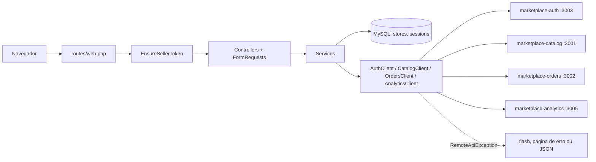

# marketplace-seller

Painel do vendedor do [marketplace](https://github.com/DeborahDalonso/marketplace):
onde quem vende cadastra a loja, gerencia produtos, acompanha pedidos e vê
quanto faturou no mês. É um cliente das APIs `catalog`, `orders` e `analytics`,
autenticado com o JWT que o `auth` emite para o vendedor.

## Stack

- PHP 8.2+, Laravel 12, Blade
- MySQL 8 para a única tabela própria (`stores`) e a sessão; SQLite em memória nos testes
- Bootstrap 5 e Bootstrap Icons via npm, Vite
- Facade `Http` para as APIs do ecossistema, facade `Log` para log
- PHPUnit para testes, Pint (preset Laravel) para estilo

## Como rodar

Precisa do MySQL do repositório guarda-chuva e dos serviços `auth`, `catalog`,
`orders` e `analytics` no ar, nas portas do `.env.example`:

```bash
# no repositório marketplace
docker compose up -d mysql redpanda
```

Depois, aqui:

```bash
cp .env.example .env
composer install
php artisan key:generate
php artisan migrate
php artisan storage:link      # logo da loja em storage/app/public
npm install
npm run build                 # ou npm run dev para recarregar ao salvar
php artisan serve --port=3004
```

Com Docker:

```bash
docker build -t marketplace-seller .
docker run --env-file .env -p 3004:3004 marketplace-seller
```

A imagem roda as migrations, cria o link do storage e sobe o `artisan serve`.

## Arquitetura



```
app/
  Exceptions/RemoteApiException.php   erro de domínio das APIs: código, status e render()
  Http/Controllers/                   um por tela; sem try/catch
  Http/Middleware/EnsureSellerToken   sem token na sessão: redirect ao login ou 401 em JSON
  Http/Requests/                      LoginRequest, StoreRequest, ProductRequest
  Models/Store.php                    a loja do vendedor, única tabela própria
  Providers/AppServiceProvider.php    URL de cada client, paginação Bootstrap, @money e @datetime
  Services/
    RemoteClient.php                  base dos clients: token, timeout, envelope e tradução de erro
    AuthClient, CatalogClient,        uma classe por API, só as rotas dela
    OrdersClient, AnalyticsClient
    SellerSession.php                 único lugar que sabe como o vendedor fica na sessão
    AuthService, StoreService,        regras do painel
    ProductService, OrderService,
    DashboardService, HealthService
config/services.php                   URLs das APIs e timeout
database/migrations/                  sessions e stores
lang/pt_BR/                           todo texto da interface, validação e paginação
resources/views/
  layouts/                            app (sidebar) e guest (login)
  components/                         card, status-badge, alert, empty-state, page-header
  auth, dashboard, store,             uma pasta por tela
  products, orders, errors
resources/css/app.css                 tokens em :root, tema escuro, Bootstrap recebendo os tokens
resources/js/sales-chart.js           gráfico de barras em canvas
tests/Feature                         telas com Http::fake() e SQLite em memória
tests/Unit                            CatalogClient traduzindo resposta em exceção
```

Fluxo de erro: o client abre o envelope `{ success, message, data }` e, se a
resposta não for de sucesso, lança `RemoteApiException` com um código de
`lang/pt_BR/errors.php` e o status que o painel vai responder. O `render()` da
exceção decide: 401 derruba a sessão e volta ao login; GET mostra a página de
erro com o botão de tentar de novo; POST volta ao formulário com flash e
`withInput()`; chamada JSON recebe `{ success: false, message, errors }`. A
resposta original da API fica só no log.

## Rotas

| Método | Rota                      | Quem          | Descrição                                                   |
| ------ | ------------------------- | ------------- | ----------------------------------------------------------- |
| GET    | `/login`                  | público       | formulário de entrada                                       |
| POST   | `/login`                  | público       | autentica em `POST {AUTH_URL}/auth/login`; 10 tentativas/min |
| POST   | `/logout`                 | vendedor      | limpa a sessão                                              |
| GET    | `/`                       | vendedor      | receita do mês, pedidos pagos, produtos ativos e gráfico    |
| GET    | `/store`                  | vendedor      | formulário da loja (vazio na primeira entrada)              |
| PUT    | `/store`                  | vendedor      | cria ou atualiza a loja; logo em `storage/app/public/logos` |
| GET    | `/products`               | vendedor      | lista paginada de `GET {CATALOG_URL}/products?sellerId=`    |
| GET    | `/products/create`        | vendedor      | formulário com as categorias do catalog                     |
| POST   | `/products`               | vendedor      | `POST {CATALOG_URL}/products`                               |
| GET    | `/products/{id}/edit`     | vendedor      | formulário preenchido                                       |
| PUT    | `/products/{id}`          | vendedor      | `PUT {CATALOG_URL}/products/{id}`                           |
| DELETE | `/products/{id}`          | vendedor      | `DELETE {CATALOG_URL}/products/{id}` (desativa)             |
| GET    | `/orders`                 | vendedor      | lista paginada de `GET {ORDERS_URL}/orders?sellerId=`       |
| GET    | `/orders/{id}`            | vendedor      | detalhe com a parte da loja separada dos outros vendedores  |
| GET    | `/health`                 | público       | `{ success, data: { service, version, mysql } }`, 503 se o banco cair |

"Vendedor" é quem passou pelo `EnsureSellerToken`: token na sessão, emitido
pelo `auth` para uma conta `seller` ou `admin`.

## Variáveis de ambiente

| Variável                       | Padrão                  | Para quê                                  |
| ------------------------------ | ----------------------- | ----------------------------------------- |
| `APP_KEY`                      |                         | gerada por `php artisan key:generate`     |
| `APP_URL`                      | `http://localhost:3004` | links absolutos e URL do logo             |
| `PORT`                         | `3004`                  | porta do `artisan serve` e do Dockerfile  |
| `MYSQL_HOST`, `MYSQL_PORT`     | `localhost`, `3306`     | banco próprio                             |
| `MYSQL_USER`, `MYSQL_PASSWORD` | `root`, `root`          |                                           |
| `MYSQL_DATABASE`               | `marketplace_seller`    | schema do painel                          |
| `AUTH_URL`                     | `http://localhost:3003` | login                                     |
| `CATALOG_URL`                  | `http://localhost:3001` | produtos e categorias                     |
| `ORDERS_URL`                   | `http://localhost:3002` | pedidos                                   |
| `ANALYTICS_URL`                | `http://localhost:3005` | relatório de vendas                       |
| `REMOTE_TIMEOUT_S`             | `5`                     | timeout de cada chamada às APIs           |
| `SESSION_DRIVER`               | `database`              | a sessão guarda o JWT; fica no banco      |

Os nomes `MYSQL_*` e `*_URL` são os mesmos em todos os serviços do marketplace
(CONTRATOS, seção 1). A conexão `mysql` do `config/database.php` lê direto
deles; não existe `DB_HOST` aqui.

## Decisões

- **Sem banco de produtos nem de pedidos.** O catalog é dono do produto e o
  orders é dono do pedido. Copiar os dados para cá criaria duas verdades e um
  sincronismo que ninguém pediu. O painel guarda só o que é dele: a loja.
- **Token na sessão, não no navegador.** O JWT fica no storage da sessão do
  Laravel (tabela `sessions`); o navegador só tem o cookie de sessão,
  `HttpOnly`. Um XSS na página não consegue ler o token, e logout é apagar a
  sessão. `SellerSession` é o único lugar que conhece as chaves.
- **Sem Breeze nem Sanctum.** Não há usuário local para o Breeze cadastrar nem
  API própria para o Sanctum proteger; quem autentica é o `auth`. Um
  middleware de dez linhas faz o papel do guard. Por isso a migration padrão de
  `users` foi removida: a tabela não teria linha nenhuma.
- **Gráfico em canvas, sem Chart.js.** É uma série só (receita por dia) com
  barras e quatro linhas de grade. Cinquenta linhas de JS desenham isso; uma
  biblioteca de gráficos somaria 200 KB para o mesmo resultado.
- **Pint com o preset Laravel.** O guia do portfólio pede PHP-CS-Fixer; o Pint
  é o PHP-CS-Fixer empacotado pelo próprio Laravel com as regras do framework.
  Mesma ferramenta, zero configuração.
- **Erro remoto em GET mostra página, não redirect.** `back()` numa falha de
  GET pode voltar para a mesma tela que acabou de falhar e virar um laço. A
  página de erro tem o botão de tentar de novo e mantém o status real (503,
  404) para quem monitora.
- **Parte da loja no pedido.** Um pedido pode ter itens de vários vendedores.
  A lista e o detalhe mostram quanto do total é desta loja, calculado no
  `OrderService` a partir do `sellerId` de cada item.
- **`artisan serve` no Dockerfile.** É o servidor embutido do PHP, um processo
  só. Para a VM de demonstração do portfólio basta e dispensa nginx e fpm; o
  comentário no Dockerfile diz onde trocar quando houver tráfego de verdade.

## Testes

```bash
php artisan test
vendor/bin/pint --test
```

Se o PHP da máquina não carrega `pdo_sqlite` e `fileinfo` pelo `php.ini`
(caso do Windows com o pacote zip), passe as extensões na linha de comando e
chame o PHPUnit direto, porque o `artisan test` abre outro processo sem elas:

```bash
php -d extension=pdo_sqlite -d extension=sqlite3 -d extension=fileinfo vendor/phpunit/phpunit/phpunit
php -d extension=pdo_sqlite -d extension=sqlite3 -d extension=fileinfo vendor/bin/pint --test
```

56 testes: login (credencial válida, inválida, `buyer` bloqueado, `admin`
aceito, logout), middleware (redirect, 401 em JSON, URL pretendida), loja
(criar, editar sem duplicar, logo no disco, slug único, isolamento entre
vendedores), produtos (lista renderiza o que o catalog devolve, criação chama
a API com o token e o preço em centavos, edição, desativação, validação sem
chamar a API), pedidos (parte da loja, detalhe, 404), painel (cartões e série
do gráfico, estado vazio, convite a criar a loja), erros remotos (flash em
pt-BR, página 503, 401 derrubando a sessão, 403, envelope JSON), health e o
`CatalogClient` traduzindo cada resposta em exceção. Tudo com `Http::fake()`
e `Http::preventStrayRequests()`; nenhum teste sai da máquina.

## Licença

MIT
